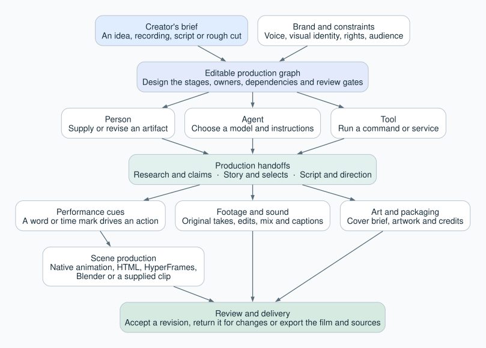

# Folio

Folio is an open-source video production workflow engine. Build a workflow once, then decide who does each job on a given film. A creator can write the story, ask an agent to research it and hand individual shots to an animator. The project records those choices alongside the material they produced. A new take can move a camera cue. A new source can reopen a script review. An artist's replacement cut stays under their control.

A project can begin with an interview recording, a history question, a storyboard or finished footage. Reuse its stages and brand rules across a series. The CLI reads ordinary files that you can edit, diff and keep with the original footage.



[Current architecture and an example revision](docs/architecture.md) · [Design proposal for recurring series, shared assets and creative control](docs/series/README.md)

## Try a production

From a checkout, install Node.js 22 or newer, Python 3.9 or newer and FFmpeg with `ffmpeg`, `ffprobe`, libx264 and AAC. The interview and history examples run locally with the included material.

```sh
npm ci
node src/cli.mjs workflow graph examples/studio-session/workflow.json
node src/cli.mjs workflow run examples/studio-session/workflow.json
```

The first run locates a selected passage in the session notes and pauses for the story editor. Submit the supplied edit or change it yourself. The next run cuts the recording, preserves the guest's pause and the two knocks inside it, makes captions and artwork, then waits for review.

```sh
node src/cli.mjs workflow override examples/studio-session/workflow.json --stage story --file examples/studio-session/editorial/story.json
node src/cli.mjs workflow run examples/studio-session/workflow.json
```

Open the movie and cover at the paths in the output. The [interview walkthrough](examples/studio-session/README.md) shows how to approve and export the cut and its editable sources.

## Choose a starting point

| What you have | What you can try |
| --- | --- |
| An idea and a preferred set of tools | [Design a workflow from a brief](docs/workflow-design.md). Supply a human proposal or have your own writer propose stages. Inspect the generated graph before running it. |
| A research question | [Run a history desk](docs/research.md). Discover sources, locate passages and carry unresolved questions through review. [Build a 49-second film](docs/history-edition.md) from two catalog records, an original performance and a timed animation. |
| A recorded conversation | [Edit a two-speaker session](examples/studio-session/README.md). Select by source time, retain the actual sound, commission a cover independently and deliver a reviewable cut. |
| A script and a performance | [Direct a shot by phrase](docs/cue-direction.md). Pan to an object, zoom during the move, reveal a measurement on the next line or keyframe a custom rig property with a Bézier curve. Replacing the take retimes the picture. |
| A 3D scene, web composition or generated clip | [Render with HyperFrames or Blender, or import media](docs/renderers.md). Two native scenes share one measured performance and export voiced cuts with captions. |
| A series with a visual identity | [Author a channel and reusable components](docs/authoring.md), [record or synthesize narration](docs/voice.md), and [build a local viewing catalog](docs/catalog.md). |

## Who does the work?

Every stage names its inputs, outputs and owner. Set a stage to `manual` to wait for a file, `command` to run a program, or `agent` to use a model-backed adapter. Each agent can have its own model, instructions and provider command. The included client supports Anthropic, Google Gemini and OpenAI. A producer can run a single branch, inspect its artifacts, request another pass, or take over a stage. A review gate belongs to the exact revision someone approved. Independent stages can share a brand file or opt out of it. [Workflow format and commands](docs/workflows.md) · [Set a model for each stage](docs/models.md)

For picture, choose how much control the source exposes. A native component can animate an individual object. An authored HTML composition or Blender scene can drive its own objects from Folio's resolved cue times. A supplied movie can be trimmed, edited and captioned. Its internal objects remain editable in the original tool. An exported clip from a video-generation service uses the media input. A direct service call requires a configured adapter. [Renderer contracts](docs/renderers.md)

The current interface is a local CLI. The architecture describes where a graphical timeline, collaborative review, multitrack editor interchange and hosted workers would attach. The default workflows run without model credentials.

## Develop

```sh
npm test
node src/cli.mjs workflow --help
node src/cli.mjs validate rolling-wheel
node src/cli.mjs proof rolling-wheel --shot fixed-axle --recordings channels/starter/reference-takes --subs both
```

The proof renders a complete voiced shot from the bundled reference take. Install the optional local voice with `python3 tools/setup_voice.py` before rendering the full starter with synthesized narration. The renderer guide lists optional test dependencies for HyperFrames and Blender.

The software is available under the [MIT license](LICENSE). See the [asset notices](NOTICE.md) for bundled typefaces and sample media.
