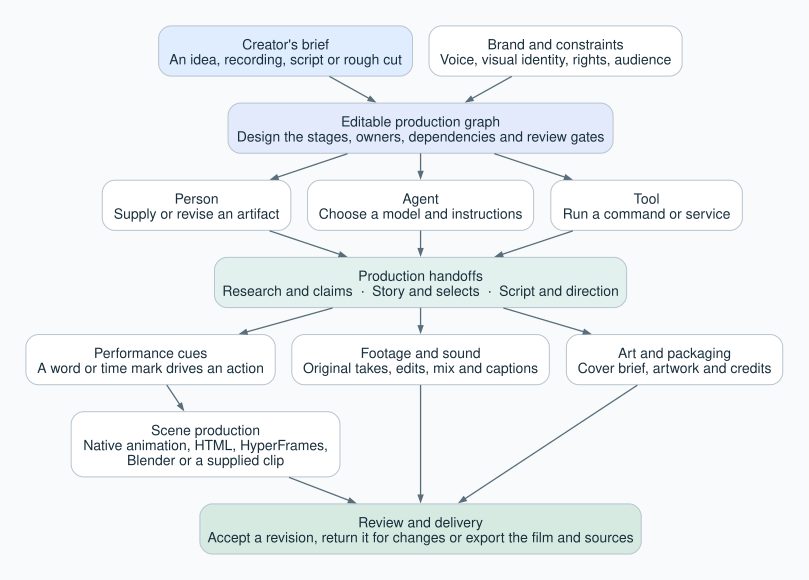

# Foliofilm architecture

Foliofilm is a local production workflow engine for video creators. Its value is continuity of creative control from an idea or recording to a finished release. A person can change the story, replace a take, work with a different artist or delegate a single stage to an agent. Those choices should survive the next render.

The diagram shows responsibilities. Each production defines its own graph. A sound editor can start before the script is locked. A thumbnail designer can work from an approved brief while the cut is rendering. A producer can omit narration entirely.

## What the first release did

The initial release was a shot renderer. It could draft an episode from supplied source notes, play recorded dialogue or TTS, start one motion at a measured sentence edge, use custom drawings, browser scenes or imported media, and deliver captions and source files. The earlier HyperFrames investigation exercised upstream capabilities. The initial release shipped without a general production graph or a HyperFrames adapter.

## Two levels of direction

**A production graph** specifies who makes each deliverable and what they need. A producer can assign research to a particular model, write the script personally, and ask a different model to review the brand. The optional model client speaks the Anthropic, Gemini and OpenAI APIs. Each stage can also call a user-supplied program. [Model configuration](models.md) Each stage hands the next one a file someone can inspect or replace. The CLI is the first client. A future board, script editor and timeline can edit the same project documents.

**A story and its timeline** describe what the audience experiences. A beat records what the audience knows going in, what changes, and which picture, sound or line makes that change intelligible. A director might move a reaction before an interview question, leave a silence unfilled, or cut the narrator altogether. A cue associates a specific performance with a named object and an action. These decisions belong in editable sources alongside their evidence and timecodes.

| Production domain | Editable handoff | Possible owners |
| --- | --- | --- |
| Development and research | Brief, leads, selected passages, claim references and open questions | Researcher, creator's own interview, search service, model with retrieval tools |
| Story edit and writing | Beat sheet, interview selects, script or treatment | Writer, reporter, transcript editor, writing agent |
| Direction | Storyboard, shot list, blocking, named objects, camera moves and cues | Director, animator, model preparing a first pass |
| Picture and sound | Takes, scene files, timelines, stems, captions, rendered clips | Recordist, TTS, editor, Blender, HTML, HyperFrames, media supplier |
| Identity and packaging | Versioned brand files, thumbnail brief, artwork and title candidates | Designer, design tool, image model, creator |
| Review and delivery | Cut, source and rights notes, revision-specific decision and release files | Editor, invited reviewer, technical checks, configured delivery tool |

## Follow a revision

~~~mermaid
sequenceDiagram
    participant P as Producer
    participant G as Workflow
    participant V as Recording
    participant D as Direction
    participant R as Renderer
    P->>G: Accept a new take and keep the approved artwork
    G->>V: Read this take and its measured alignment
    D->>G: On the second occurrence of a phrase, pan to the named object
    V->>G: Return that occurrence's start and end
    G->>R: Render the pan and reveal at their new times
    R-->>P: Revised cut, frame positions and editable sources
~~~

Two identical lines may serve different dramatic purposes. A missing or ambiguous anchor needs an editorial choice. An exported movie alone cannot expose the objects or camera curves that made it. Keep the native scene and cue inputs when the work needs future direction. A recording-only edit can work on source time ranges and preserve the original audio.

## Where control lives

- **Project files** hold the graph, approved inputs and brand rules. Research and direction can change independently. Reviewers can inspect a passage or listen at a timecode.
- **The runner** follows dependencies. A manual stage waits for a supplied file. A command stage runs a declared program. An agent stage can invoke a model-backed adapter with its own configuration. Review gates bind decisions to a revision. An override lets a person take over a handoff.
- **Adapters** translate files into a tool's native project, command or API. Some return a finished take. Others can consume cues and expose their original objects. Each tool determines what remains editable.
- **Brand controls** are inputs. A renderer can apply palette values deterministically. A writer can consult a voice guide. An editor can approve an intentional departure. Merely passing a brand file to a model cannot establish compliance.
- **Review** can check factual support, attribution, timing, sound, legibility and thumbnail accuracy. A matching quote establishes that a passage exists. A reviewer decides whether it supports the claim. A successful encode establishes technical integrity. The creator decides whether the piece is ready.

## Three ways in

| Starting material | One possible workflow | An editorial choice that should survive automation |
| --- | --- | --- |
| Recorded podcast | Ingest → transcript/selects → edit with original audio → captions and cover | Preserve a guest's pause even if a silence detector would shorten it. |
| History investigation | Source discovery → archived evidence → competing explanations → script → map or reconstruction → fact review | Attribute a disputed date and show the document under discussion. |
| Fictional short | Treatment → performances and storyboards in parallel → blocking → visual effects → sound mix and review | A character's reaction can begin before another stops speaking. The director chooses the overlap. |

## Product boundary

Foliofilm coordinates tools and files. Detailed editing depends on what each adapter can read and write. A workflow can call a service via a creator-configured command, which runs with the creator's permissions. The service determines its usage, credentials and cost.

The [README](../README.md) identifies the runnable paths. A graphical editor, collaborative review across users, bidirectional multitrack editor interchange, and hosted workers with provider budgets are future work. Publishing to a public platform is a separate, explicit integration.

## What to adopt and what to build

OpenFilm already lets a person and a coding agent edit the same film. It offers a screening view, a canvas, a multitrack timeline and export to desktop editors. For a creator whose main problem is hands-on timeline editing, it is a strong starting point. A Foliofilm stage can receive a cut from that editor today. A live, bidirectional project bridge would be a separate integration. [OpenFilm project and editor capabilities](https://github.com/openfilm/openfilm)

HyperFrames has its own compositing model, nested HTML compositions and render CLI. Foliofilm supplies selected assets and measured cue positions, invokes that renderer, and receives the resulting plate. An artist keeps the HTML source. Remotion similarly exposes reusable React compositions through props and schemas. A project can invoke an existing Remotion render command. The bundled, tested external scene adapters are HyperFrames and Blender. [HyperFrames compositions](https://hyperframes.app/docs/2-concepts/1-compositions) · [Remotion parameterized videos](https://www.remotion.dev/docs/parameterized-rendering) · [Foliofilm renderer examples](renderers.md)

Foliofilm's design bet is that the handoffs *between* those tools deserve their own project format. An editor can ask which source supports a spoken claim, which clips use an old take, who approved a cover, and which branch needs another pass. Review and override are core operations because two people can reasonably make different films from the same evidence. Wider interoperability should preserve media references and editorial decisions in a format a working editor can reopen. OpenTimelineIO provides a candidate interchange layer for cuts and timing. [OpenTimelineIO](https://github.com/OpenTimelineIO/OpenTimelineIO)
