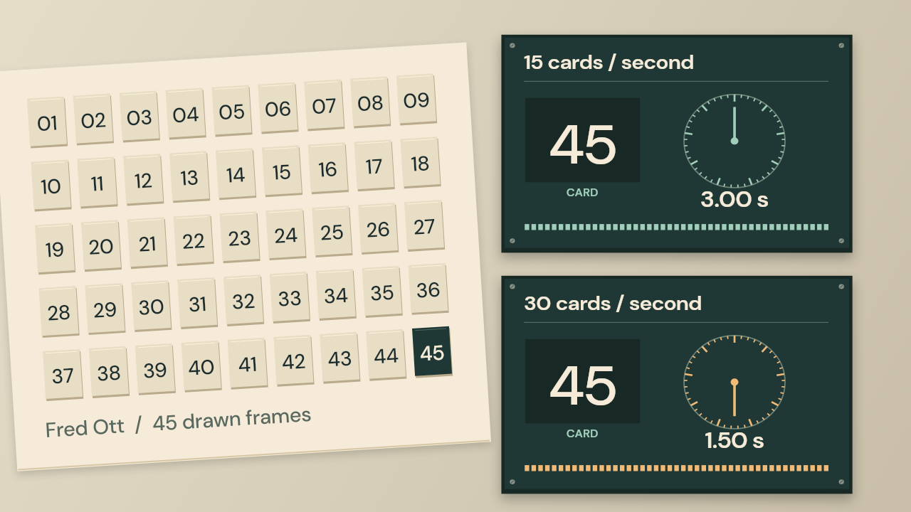

# A History Desk film from two catalog records



*How long is one sneeze on paper?* uses the reviewed History Desk script to reconstruct a viewing experiment. A moving aperture reads a numbered sheet. Two instruments then show its 45 cards at different rates. When the faster one freezes, the slower neighbor is still running. The intervals of 3.00 and 1.50 seconds belong to this experiment. The film leaves Fred Ott's historical playback rate open. [Photographic record](https://www.loc.gov/item/2025169913/) · [Moving-image record](https://www.loc.gov/item/00694192/)

## Watch the edition

With Node 22 or later, Python 3, FFmpeg and FFprobe available, run from the checkout root. The checked-in performance supplies the voice. Each stage uses local files and the installed Node dependencies.

```sh
npm ci
node src/cli.mjs workflow run examples/history-desk/workflow.json --stage edition
mkdir -p release
node src/cli.mjs workflow export examples/history-desk/workflow.json --stage edition --dir release/history-desk
```

Open `release/history-desk/sneeze-on-paper.mp4`. The source edition is 1280 × 720 at 30 fps and runs about 49 seconds. The export directory must be new. On subsequent runs, use the existing export for the same revision or choose a fresh folder for a changed cut.

The export includes the MP4, VTT and SRT subtitles, PNG cover, script, directions and a source map. The source map contains both catalog URLs and passage locators, accepted claims, the review of the script and board, the original take's digest, measured sentence boundaries, the measured clock trials and checksums for the delivered media. [Evidence and editorial review](research.md)

## Follow the four production handoffs

| Stage | Input and decision | Output |
| --- | --- | --- |
| `narration` | Matches the supplied mono FLAC and measured sentence spans against the accepted script. Every beat inherits its source links. | Performance and timed alignment |
| `picture` | Checks the fingerprints of the accepted script, storyboard and brand. Draws the numbered tiles, moving aperture and independent clocks. The spoken comparison starts each clock trial. | Silent plate, cover, source edit and frame-level directions |
| `cut` | Combines the plate with the lossless performance using the ordinary workflow edit adapter. | H.264/AAC film, VTT captions and edit timeline |
| `edition` | Pairs the cut with its script, picture directions, timed references and signed review. | Watchable, captioned delivery |

The clock shafts use the same three-second dial scale. They run at 15 and 30 cards/s. Each card occupies one complete interval, including the last. At 1.50 seconds the right instrument has finished its forty-fifth card, while the left is showing card 23. The comparison plays a second time with the narrator's second rate so viewers can watch either window. [Drawing code](../examples/history-desk/tabletop.mjs) · [Reviewed storyboard](../examples/history-desk/editorial/storyboard.json)

The repository supplies two short catalog excerpts, the editorial decisions, an original diagram program and a new synthetic reading in Kokoro's `af_bella` voice. The claims come from the catalog records. The project authors drew the tiles and instruments, chose the two illustrative rates and measured the reading's PCM clip lengths. The edition uses those drawings throughout. [Reference take and measured timings](../examples/history-desk/performance) · [Kokoro model card](https://huggingface.co/hexgrad/Kokoro-82M)

## Change the performance or visual

To record another reading, supply mono 24 kHz FLAC and a timing file with the same four beat IDs. Each beat has its measured first sample, its exclusive last sample and caption sentence rows in seconds relative to the whole performance. `referenceSha256` identifies the exact FLAC. Preserve the script wording or have the editor approve the revised script first. Allow at least three seconds for each clock trial.

The optional generator uses the normal speech interface. After installing the local voice, it can produce new fixtures in an unused directory. An external worker config can also be supplied with `--voice-worker`. Point the workflow's `narration` inputs to the new take and timing file before running it.

```sh
python3 tools/setup_voice.py
node examples/history-desk/generate-voice.mjs --script examples/history-desk/editorial/script.json --out examples/history-desk/new-performance
```

Each handoff can be inspected on its own through `workflow status`, or replaced using `workflow override`. For a replaced performance, supply the matching alignment before rendering the picture. For a changed visual, update the plate, cover and any changed timing handoffs. A changed script or storyboard requires the reviewer's signoff on the new material. [Revision and approval commands](workflows.md)
