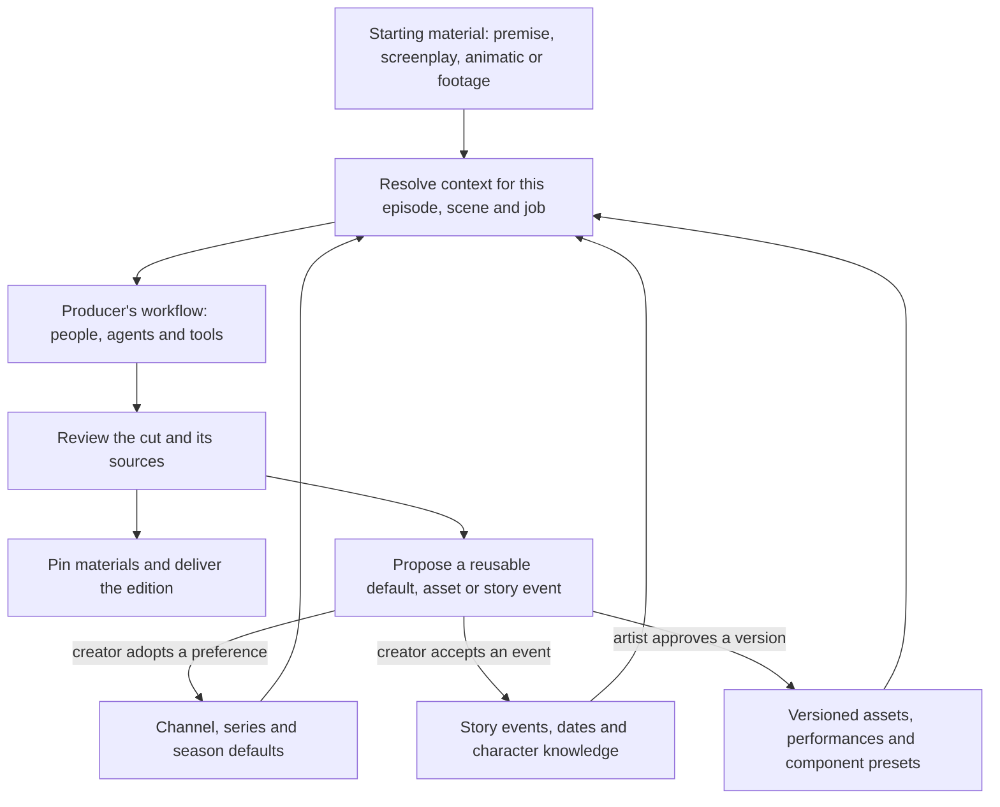

# Designing a series in Folio

**Design proposal.** A creator opening a new episode should be able to say “use the usual kitchen, but shoot this scene from the doorway.” Folio would need to find the kitchen they mean, resolve its appearance at this point in the story, apply the camera direction to this scene, and explain each choice. The next episode should still start with the usual camera setup.

The public CLI already coordinates the work inside a production. This proposal covers what creators can carry *between* productions. A single video can still start from a recording or a few files. A channel with several shows could share its fonts and delivery settings while giving each show its own characters, humor and visual language.

## Design guide

| Creator's question | Where to look |
| --- | --- |
| What did this episode inherit? Can I teach Folio a preference from an earlier cut? Who knows about a story event? | [Context, defaults and continuity](context.md) |
| How do I commission a prop, reuse a rig, match a voice, or change a camera move across a series? | [Assets, performances and reusable components](assets.md) |
| What if all I have is the plot? What if my edit and dialogue are already final? | [Scripts, structure and creative ownership](scripts.md) |
| How would we know the design actually works for animation, education and recorded material? | [Two-episode pilot and acceptance criteria](pilot.md) |

## How an episode would take shape

These arrows describe decisions across a series. Each episode would still run as its own production graph. Finishing a cut and adopting one of its choices across the show are separate actions. A late edit to a thumbnail, for example, can ship with the episode without redefining the channel palette.

The writer, animator and editor might all be the same person. They still need different views. A writer opening a flashback needs the relationships and facts available at that point. An animator needs the approved prop state, rig and performance marks. A thumbnail designer needs the selected artwork, title brief and any spoiler restriction. The producer should be able to inspect exactly which material each person or configured model received.

## What a creator can do today

| Area | Available in the public CLI | Proposed addition |
| --- | --- | --- |
| Channel identity | A channel's brand file supplies theme and voice settings. A workflow stage can receive a brand file or opt out. | Inherit settings through series, season and scene. Show where a choice came from and preview a narrower override. |
| Reuse | Projects can use drawing modules, local media, custom cameras and transitions, HTML compositions and Blender scenes. Workflow catalogs can name local input files. | Find an asset across episodes by identity, story state, version and usable representation. Trace its use back to individual shots. |
| Story and research | A workflow can pass a beat sheet, source record, script, edit decision list or storyboard between owners. The history example connects claims to spoken beats. | Track character knowledge, subplots and event order across episodes. Carry the relevant parts into a new brief. |
| Direction and sound | Measured phrases and marks can drive camera motion, reveals and named object properties. Recordings, synthesis and independently rendered pictures can feed a cut. | Reuse a cast member's expression vocabulary, native rig bindings, voice direction and performance examples across different tools. |
| Human control | A creator can select a stage owner and model, replace a stage output, review a revision and export it. | Let the creator preserve a particular line, pause or gesture while delegating the surrounding work. |
| Delivery | Example workflows export films, covers, captions and editable production materials. | Pin the resolved cross-episode context, continuity decisions and asset revisions with each edition. |

See the existing [workflow commands](../workflows.md), [channel authoring guide](../authoring.md), [research workflow](../research.md), [model configuration](../models.md), [performance cues](../cue-direction.md) and [renderer adapters](../renderers.md).

For a project starting today, a creator can declare their series notes, selected character sheets and approved source files as ordinary workflow inputs. They can give the research and writing stages different material and submit a finished recording or drawing as a manual handoff. The producer currently chooses the relevant files and versions. The proposed series features would make that choice inspectable, repeatable and easier to revise. [Design a workflow with a creator-owned catalog](../workflow-design.md)

## What travels with the cut

The project would keep three records an editor could inspect independently.

1. **The inputs to a creative decision.** For the doorway shot, record the inherited camera choice, the scene override, the drawing or animatic that supports it, who chose it and the revision used. This answers “why here?” even after the show guide changes.
2. **What went into the picture and sound.** Record the mug's state and design revision, the representation loaded by the renderer, the selected take, its measured timing, and the rig property or edit point the cue drives. An imported, already-rendered clip should retain a link to the editable original when one is available. A generator prompt by itself cannot stand in for the actual selected footage.
3. **What the editor accepted and shared.** Bind the review to a specific cut. Keep a local record of the editable sources and which items the creator chose to include in each delivery. A screening copy, a collaborator's editing package and a public tool example have different audiences. A creator's series bible, recipes, voice references and private boards belong to their own project.

In one workflow an artist can use Blender for a rig, a web composition for a diagram and an externally generated clip for a dream sequence. Each receives the material its author selected and returns a declared artifact. Research could have its own model, direction another, and a person could do the final brand review. An editor who already has approved picture and sound can skip those upstream jobs. The proposed records describe the actual path the creator chose.

## Decisions to test before settling the format

| Open question | Starting proposal and test |
| --- | --- |
| Who authors the first defaults? | Allow a blank start, a creator-written guide or suggestions from creator-selected examples. Compare what a newcomer can explain and correct in each approach. |
| How much should Folio infer from earlier work? | Start with opt-in suggestions that cite the original scenes. Test whether creators want to delegate recurring low-impact choices, and at which scope. |
| How should contradictory instructions surface? | Explain the two sources and affected shots. Try automatic resolution for unambiguous preferences and an editorial decision for incompatible story facts. |
| How much belongs in a shared asset record? | Start with identity, version, source, dependencies and capabilities. Use the same named prop in a drawing and a 3D scene to discover which details belong to each adapter. |
| What should happen when a shared asset changes? | Show the candidate edit and affected work before adoption. Keep released editions pinned. Measure whether producers can distinguish a visual redesign from an event inside the story. |
| What belongs in a future drawing board or GUI? | Start with reference items, annotations and links to decisions that a CLI project can retain. Test which activities need spatial arrangement, playback or frame-accurate interaction. |

The proposed first implementation would resolve explicitly authored defaults and fixed asset references in the two-episode pilot. That makes it possible to test human ownership, story order and revision impact before adding model suggestions or a graphical board.
