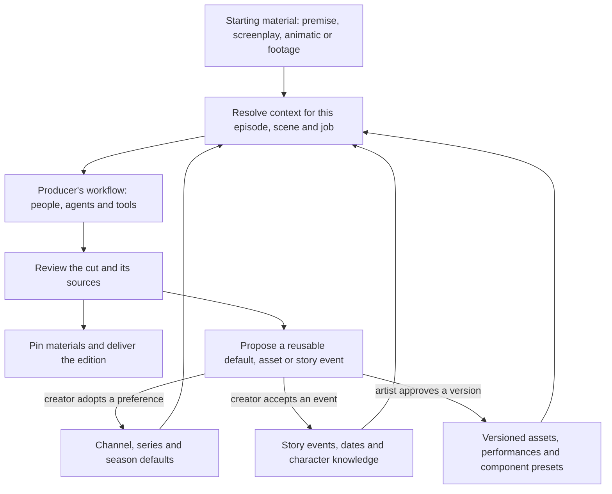

# Producing a series in Folio

A new episode can inherit the kitchen, cast, timing and camera from the show. Give one scene a doorway camera and the next scene goes back to the usual wide shot. Folio can show which instruction selected each camera, which mug drawing went to the animator and which revision an editor delivered.

[Start your own series](start.md) · [Run the kitchen pilot](../../examples/kitchen-series/README.md) · [Series commands](commands.md) · [Architecture](../architecture.md)

## Design guide

| Creator's question | Where to look |
| --- | --- |
| What did this episode inherit? Can I teach Folio a preference from an earlier cut? Who knows about a story event? | [Context, defaults and continuity](context.md) |
| How do I commission a prop, reuse a rig, match a voice, or change a camera move across a series? | [Assets, performances and reusable components](assets.md) |
| What if all I have is the plot? What if my edit and dialogue are already final? | [Scripts, structure and creative ownership](scripts.md) |
| How would we know the design actually works for animation, education and recorded material? | [Two-episode pilot and acceptance criteria](pilot.md) |

## How an episode takes shape

These arrows describe decisions across a series. Each episode can run as its own production graph. Finishing a cut and adopting one of its choices across the show are separate actions. A late edit to a thumbnail, for example, can ship with the episode without redefining the channel palette.

The writer, animator and editor might all be the same person. They still need different views. A writer opening a flashback needs the relationships and facts available at that point. An animator needs the approved prop state, rig and performance marks. A thumbnail designer needs the selected artwork, title brief and any spoiler restriction. The producer should be able to inspect exactly which material each person or configured model received.

## What you can use in a project

| Production choice | Working interface |
| --- | --- |
| Start with a blank guide or hand down a default | [Declare role-scoped defaults](context-format.md). Use `series why` to inspect a decision, its source and what it overrides. |
| Teach a preference from previous work | [Select evidence and review a proposal](preferences.md). Run locally or configure a writer. Promote the proposal to a particular scope. |
| Keep track of the story world | [Author an event](context-format.md) with a story time, a time for each character to learn it and an optional audience reveal. The resolver selects what is available to the current contributor. |
| Give a contributor a specific version of a prop, font, rig or take | [Register local source material](intake.md), declare native representations and required controls, preview affected work and adopt a revision in one use. [Library format](library-format.md) |
| Work from a premise, a recording or a frame-accurate animatic | Choose a workflow for that material. [Define optional beat suggestions and protect individual fields](script-format.md). The picture and sound adapters determine how to realize those fields. |
| Direct an action against spoken words | [Bind a cue to a particular performance](../cue-direction.md). The measured phrase can drive overlapping camera and object moves. |
| Send scoped material to a person or a tool | Bind a workflow stage to an episode, role and optional shot. A graph can mix manual work, local commands and configured models. [Handoff and edition walkthrough](commands.md) |
| Keep a release usable after a redesign | Pin the accepted cut, exact stage revisions, declared delivery files and shareable source bytes. Verify the package offline. [Edition and rights format](library-format.md) |

## What travels with the cut

The project keeps local production records alongside the separately assembled delivery.

1. **The inputs to a creative decision.** For the doorway shot, record the inherited camera choice, the scene override, the drawing or animatic that supports it, who chose it and the revision used. This answers “why here?” even after the show guide changes.
2. **What went into the picture and sound.** Record the mug's state and design revision, the representation loaded by the renderer, the selected take, its measured timing, and the rig property or edit point the cue drives. An imported, already-rendered clip should retain a link to the editable original when one is available. A generator prompt by itself cannot stand in for the actual selected footage.
3. **What the editor accepted and shared.** Bind the review to a specific cut. Keep a local record of the editable sources and which items the creator chose to include in each delivery. A screening copy, a collaborator's editing package and a public tool example have different audiences. A creator's series bible, recipes, voice references and private boards belong to their own project.

In one workflow an artist can use Blender for a rig, a web composition for a diagram and an externally generated clip for a dream sequence. Each receives the material its author selected and returns a declared artifact. Research could have its own model, direction another, and a person could do the final brand review. An editor who already has approved picture and sound can skip those upstream jobs. The workflow receipt identifies the path the creator chose.

## Decisions to test before settling the format

| Open question | Starting proposal and test |
| --- | --- |
| Who authors the first defaults? | Allow a blank start, a creator-written guide or suggestions from creator-selected examples. Compare what a newcomer can explain and correct in each approach. |
| How much should Folio infer from earlier work? | Start with opt-in suggestions that cite the original scenes. Test whether creators want to delegate recurring low-impact choices, and at which scope. |
| How should contradictory instructions surface? | Explain the two sources and affected shots. Try automatic resolution for unambiguous preferences and an editorial decision for incompatible story facts. |
| How much belongs in a shared asset record? | Start with identity, version, source, dependencies and capabilities. Use the same named prop in a drawing and a 3D scene to discover which details belong to each adapter. |
| What should happen when a shared asset changes? | Show the candidate edit and affected work before adoption. Keep released editions pinned. Measure whether producers can distinguish a visual redesign from an event inside the story. |
| What belongs in a future drawing board or GUI? | Start with reference items, annotations and links to decisions that a CLI project can retain. Test which activities need spatial arrangement, playback or frame-accurate interaction. |

The pilot implements the two episodes locally. Future work includes a spatial drawing board, automatic observation extraction from footage, collaborative editing and richer interchange between different native rigs. The current renderer or artist still has to implement any control they declare. [Pilot and verification guide](pilot.md)
